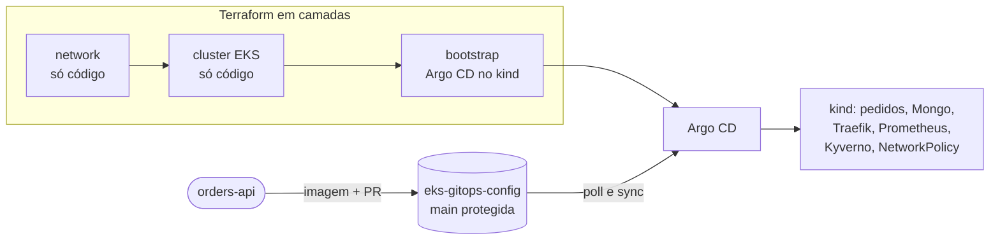

# eks-gitops-platform

Plataforma Kubernetes na AWS criada em camadas com Terraform e operada por GitOps (Argo CD), com observabilidade
e guardrails. Os manifestos que o Argo CD lê ficam em [`eks-gitops-config`](https://github.com/heldemfilipe/eks-gitops-config).

> **Status: projeto de estudo concluído, 100% local.** **Nada foi aplicado na AWS** (custo real: US$ 0). O código das
> camadas AWS (rede, EKS, IAM) foi escrito, validado e testado offline; o cluster de verdade é um `kind` local, onde
> rodaram Argo CD, ingress, segredos, observabilidade e guardrails. O que não foi executado está marcado como tal.

## Problema

Um cluster que sobe e roda um Hello World não mostra nada. O que vale mostrar são as decisões, o que acontece
quando algo falha e como se opera: criar em camadas, entregar por Git, observar, barrar o que é inseguro.

## Visão geral



Três camadas de Terraform (`network`, `cluster`, `bootstrap`) e um ciclo GitOps: a imagem nova entra por pull
request no repositório de config e o Argo CD sincroniza o cluster depois do merge. Ninguém roda `kubectl apply` à mão
no caminho normal.

## Como está dividido

| Pasta | O que tem |
|---|---|
| `terraform/network` | Rede, usando o módulo `network` do [terraform-aws-foundation](https://github.com/heldemfilipe/terraform-aws-foundation) por tag. Só código, não aplicado |
| `terraform/cluster` | EKS e identidades (Pod Identity). Só código, não aplicado |
| `terraform/bootstrap` | Argo CD por `helm_release`. Aplicado no `kind` local |
| `kind/` | Configuração do cluster local |
| `policy/` | Políticas em Rego (conftest) para o código Terraform |
| `scripts/` | Auxiliares do `Makefile` |
| `docs/` | Um guia por etapa; comece por [docs/00-roteiro-passo-a-passo.md](docs/00-roteiro-passo-a-passo.md) |

## Principais decisões

| Decisão | Motivo |
|---|---|
| Camadas AWS só em código, nunca aplicadas | Sem free tier e sem risco de cobrança; validação offline cobre o que dá |
| Traefik no kind no lugar do AWS Load Balancer Controller | O ALB só existe na AWS; o `ingress-nginx` foi arquivado em março de 2026 |
| External Secrets com o provider `fake` | Mesmo mecanismo do Secrets Manager, sem AWS |
| Calico no kind | O CNI padrão do kind (kindnet) não aplica NetworkPolicy |
| Entrega por PR no config, `main` protegida | O Git é a fonte da verdade; mudança entra por revisão |
| Kyverno com `NamespacedValidatingPolicy` | `ClusterPolicy` está obsoleto no Kyverno 1.19 |
| Imagem da API construída localmente | Nada passa por GHCR nem por Actions; o PR troca a tag e o `kind load` entrega a imagem |

## Versões

| Peça | Versão | Observação |
|---|---|---|
| Kubernetes no EKS (declarado no código) | 1.37 | Confirmada em 01/11/2026 como a mais nova do EKS, com suporte padrão até 01/12/2027 |
| Módulo EKS | terraform-aws-modules/eks 21.29.0 | Versão fixa |
| Chart do Argo CD | argo-cd 10.11.6 | Instala o Argo CD v3.5.6 |
| Kubernetes no kind | v1.37.0 | Imagem padrão do kind v0.33.0 |
| kube-prometheus-stack | 92.17.0 | Prometheus, Alertmanager e Grafana |
| Kyverno | chart 3.9.2 (v1.19.2) | |
| Terraform | 1.16 ou mais novo | |

## Etapas

- [x] Etapa 0: repositórios, estrutura e ferramentas
- [x] Etapa 1: kind e Argo CD (veja [docs/01-kind-argocd.md](docs/01-kind-argocd.md))
- [x] Etapa 2: Terraform em camadas (rede e cluster validados offline; bootstrap aplicado no kind; veja [docs/02-terraform-camadas.md](docs/02-terraform-camadas.md))
- [x] Etapa 3: identidade e ingress (Pod Identity só em código; Traefik e External Secrets reais no kind; veja [docs/03-identidade-ingress.md](docs/03-identidade-ingress.md))
- [x] Etapa 4: entrega contínua (script que abre o PR no config e sync do Argo medido; job do Actions removido, por decisão; veja [docs/04-entrega-continua.md](docs/04-entrega-continua.md))
- [x] Etapa 5: observabilidade (kube-prometheus-stack, ServiceMonitor, dashboard e alertas no kind; veja [docs/05-observabilidade.md](docs/05-observabilidade.md))
- [x] Etapa 6: guardrails e experimentos de falha (Kyverno, NetworkPolicy, PDB, HPA e cinco experimentos no kind; veja [docs/06-guardrails-e-falhas.md](docs/06-guardrails-e-falhas.md))
- [x] Etapa 7: fechamento (custo estimado em [docs/07-custo-estimado.md](docs/07-custo-estimado.md) e runbook de upgrade, não executado, em [docs/08-runbook-upgrade.md](docs/08-runbook-upgrade.md))

## Como rodar

Requisitos: Docker Desktop ligado, `kind`, `kubectl`, `helm`, `terraform` e `make`.

```bash
make up            # kind, Calico, Argo CD (Terraform, camada bootstrap) e o root.yaml; ~167 s
make down          # apaga o cluster; ~4 s
make validate-aws  # fmt, validate e terraform test nas camadas network e cluster (nunca há apply)
make policy        # opa test e conftest sobre o plano real da rede
make scan          # Trivy no código próprio
make grafana-ui    # port-forward do Grafana (senha: make grafana-senha)
```

Depois do `make up`, o Argo CD instala sozinho tudo o que está no `eks-gitops-config`. A imagem da API é construída
na máquina (`docker build` no `orders-api`) e carregada com `kind load docker-image`.

## Status do que foi feito

| Peça | Status |
|---|---|
| `terraform/network` | validado, 16 recursos no plan offline, **não aplicado** |
| `terraform/cluster` | validado e testado com mock; `plan` offline não executado (o módulo EKS consulta o STS); **não aplicado** |
| `terraform/bootstrap` | **aplicado no kind** (Argo CD v3.5.6) |
| Argo CD, Traefik, External Secrets, kube-prometheus-stack, Kyverno, metrics-server | **executados no kind** |
| Pod Identity (LBC e ESO), ALB, Secrets Manager reais | **não executado** (só código e testes) |
| Job do GitHub Actions que abre o PR no config | **removido** por decisão; o script roda na máquina |
| Capturas de tela do Alertmanager e do dashboard | **não feitas** (resultado em texto no docs/05) |
| Runbook de upgrade do EKS | **não executado** (docs/08) |

## Experimentos

| Experimento | Status | Resultado observado |
|---|---|---|
| Self-heal | executado | O Argo CD recriou o Deployment apagado; 2 réplicas `Ready` em cerca de 21 s |
| Drift manual | executado | `scale --replicas=5` voltou a 2 em cerca de 4 s |
| Rollback | executado | Tag quebrada: pod novo em `ImagePullBackOff` e os antigos seguiram `Running`; `git revert` voltou a `Synced/Healthy` em cerca de 7 s |
| Segredo entregue pelo External Secrets | executado (provider `fake`) | `Secret pedidos-mongodb` criado no namespace da API |
| Ingress | executado (Traefik, não ALB) | `Host: pedidos.localhost` devolve `200`; sem o `Host`, `404` |
| Negação de segredo | parcial | `ExternalSecret` em outro namespace recusado; `AccessDenied` real da AWS: **não executado** |
| Entrega contínua | executado | PR em ~5 s, check ~10 s, imagem aplicada ~82 s depois do merge |
| `CrashLoopBackOff` x `ImagePullBackOff` | executado | Reinícios (4 x 0) disparam alertas diferentes, em ~126 s |
| Política do Kyverno | executado | Pod ruim negado com a mensagem das 3 políticas |
| NetworkPolicy | executado | Outro namespace: timeout na API e no Mongo; Traefik e Prometheus seguem |
| `kubectl drain` | executado | 186 requisições, todas `200` |
| k6 e HPA | executado | 2 para 4 réplicas em 37 s; 11 falhas de 57.587 `POST`, causa não investigada |
| Mongo indisponível | executado | Pods `Ready`, mas `GET /pedidos` devolve `500` depois de 30 s |

## Comparação com o Argo CD gerenciado e com o fluxo local

| | Este projeto (Argo CD no `kind`) | Argo CD gerenciado pelo EKS |
|---|---|---|
| Onde roda | Pods no próprio cluster | Controladores fora do cluster, mantidos pela AWS |
| Instalação e upgrade | Chart do Helm pelo Terraform; você atualiza | Capability do EKS; a AWS atualiza |
| Custo | US$ 0 (máquina local) | Cobrado por Application-hora ([AWS EKS pricing](https://aws.amazon.com/eks/pricing/)); valores não conferidos aqui |
| Autenticação | Senha local do admin | Segundo a documentação de terceiros que li, exige o IAM Identity Center; **não verifiquei** |

Diferenças entre o laboratório e o que a AWS teria: ingress (Traefik no lugar do ALB), segredos (provider `fake` no lugar
do Secrets Manager), CNI (Calico no lugar do VPC CNI com NetworkPolicy), nós (3 contêineres no lugar de 2 `t3.large`
em Spot) e rede (sem NAT, sem sub-redes). O comportamento sob falha de nó e de zona não foi ensaiado.

## Custo

**Custo real: US$ 0**, porque nada é aplicado na AWS. A estimativa do que o código criaria (cerca de US$ 0,26 a 0,28
por hora, **estimado, nada foi cobrado**) está em [docs/07-custo-estimado.md](docs/07-custo-estimado.md).

## Licença

MIT. Veja [LICENSE](LICENSE).
