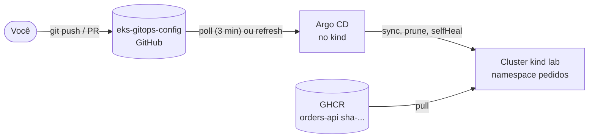

# 01 - Laboratório local: kind e Argo CD (Etapa 1)

O fluxo commit, sync e deploy rodando de graça num cluster local. Nada aqui usa a AWS.

## Fluxo

O `root` (app-of-apps) lê `apps/`; cada Application aponta para uma pasta de `workloads/`. Mudança no cluster
só entra por commit no repositório de config.

## Ambiente

| Peça | Versão / valor |
|---|---|
| kind | v0.33.0, 1 control-plane e 2 workers, sem CNI padrão |
| Kubernetes no kind | v1.37.0 (imagem padrão do kind v0.33.0) |
| CNI | Calico v3.33.0 (aplica NetworkPolicy; usado na Etapa 6) |
| Argo CD | v3.5.6 (3.5 é a minor estável mais recente; 3.6 estava em RC) |
| kubectl usado | 1.36.1, o que vem com o Docker Desktop (o do choco, 1.30.3, estava fora da faixa de ±1 minor) |
| API | `ghcr.io/heldemfilipe/orders-api:sha-bfef4cad…` com o perfil `cloud`, MongoDB 7.0 como Deployment no cluster |

Como subir: `make up` (cria o cluster, instala o Calico e o Argo CD e aplica o `root.yaml`). Como zerar: `make down`.

## Como a API foi verificada

Com `kubectl port-forward svc/pedidos`: `GET /actuator/health` devolveu `200`, `/actuator/health/liveness` devolveu
`{"status":"UP"}`, e `POST /pedidos` seguido de `GET /pedidos` gravaram e leram um pedido no Mongo do cluster.

## Experimentos

Executados em 2026-10-29. Os tempos incluem o intervalo de 3 a 6 segundos do meu laço de medição.

| Experimento | Como montei | Esperado | Observado |
|---|---|---|---|
| Self-heal | `kubectl -n pedidos delete deployment pedidos` | O Argo CD recria | O Deployment já existia de novo na primeira checagem (5 s) e as 2 réplicas ficaram `Ready` em cerca de 21 s |
| Drift manual | `kubectl -n pedidos scale deployment pedidos --replicas=5` | Volta ao valor do Git | `spec.replicas` voltou de 5 para 2 em cerca de 4 s; a aplicação ficou `Synced` |
| Rollback | Commit trocando `newTag` por `sha-quebrada`, depois `git revert` | Volta sem nenhum `kubectl` de correção | Com o commit quebrado: 1 pod novo em `ErrImagePull` e `ImagePullBackOff`, os 2 pods antigos continuaram `Running` e a aplicação ficou `Synced/Progressing` por 91 s sem derrubar o serviço. Depois do `git revert` e do push: `Synced/Healthy` em cerca de 7 s, 2 pods `Running` |

Observações:

- No rollback, o `refresh` foi forçado com `kubectl annotate app pedidos argocd.argoproj.io/refresh=hard`. Sem isso o
  Argo CD só vê o commit no próximo poll, que é de 3 minutos por padrão.
- O rolling update protegeu o serviço: com tag inexistente o pod novo nunca fica `Ready`, e o antigo não é removido.
  Isso mostra por que o alerta de reinício (Etapa 5) precisa de `CrashLoopBackOff`, e não de `ImagePullBackOff`.
- O `kubectl apply` do `root.yaml` emitiu um aviso sobre o nome do finalizer
  (`resources-finalizer.argocd.argoproj.io`). É o nome documentado pelo Argo CD e funciona; o aviso é só de estilo.

## Decisões

| Decisão | Motivo |
|---|---|
| `MONGODB_URI` direto no Deployment | A URI não tem credencial (Mongo sem autenticação, só no laboratório), então pode ficar no Git. Na Etapa 3 vira um Secret entregue pelo External Secrets |
| Tag `sha-…` e nunca `latest` | A política do Kyverno (Etapa 6) proíbe `latest`, e o CI da API já publica o `sha-<commit>` |
| Imagem puxada direto do GHCR | O pacote é público (confirmado com `docker pull` sem login) |
| `securityContext` explícito | O Kyverno avalia o pod, não o `USER` do Dockerfile |
| Push direto na `main` do config | Ainda não há proteção de branch; ela entra na Etapa 4 |
