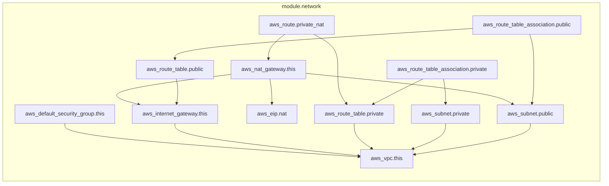

# 02 - Terraform em camadas (Etapa 2)

Três camadas, três states, ordem fixa: `network`, `cluster`, `bootstrap`. **Só a `bootstrap` é aplicada**, e só no
`kind`. As outras duas são código AWS escrito, validado e testado offline; nada é aplicado na AWS.

## Camadas e status

| Camada | O que faz | Status | Como foi verificada |
|---|---|---|---|
| `terraform/network` | VPC, 2 sub-redes públicas e 2 privadas, 1 NAT, usando o módulo do foundation `?ref=v1.2.0` com as tags do EKS e do ALB | validado, **não aplicado** | `validate`, `terraform test` (2), `plan` offline: **16 a criar**, conftest sobre o plano real: 7 testes |
| `terraform/cluster` | EKS 21.29.0, access entries, nós Spot `t3.large`, add-ons `vpc-cni` (com NetworkPolicy), `eks-pod-identity-agent`, `kube-proxy`, `coredns` | validado, **não aplicado** | `validate`, `terraform test` (5, com `mock_provider`), `tflint` e Trivy. **`plan` offline: não executado** (veja abaixo) |
| `terraform/bootstrap` | Argo CD pelo `helm_release` (chart 10.11.6 = Argo CD v3.5.6) | **executado no kind** | `apply`, `plan` seguinte sem mudanças (exit 0), `terraform test` (2) |

Comandos: `make validate-aws` (camadas AWS), `make policy` (Rego e conftest), `make scan` (Trivy), `make up` e
`make down` (kind e bootstrap).

## Por que o `plan` do cluster não roda offline

O módulo `terraform-aws-modules/eks` consulta `aws_caller_identity` (STS) e outros dados da conta. Com credenciais
falsas isso falha mesmo com `skip_requesting_account_id`: `Error: reading STS Caller Identity`. A camada `network`
não tem esse problema e planeja offline normalmente. Para o cluster, a cobertura vem do `terraform test` com
`mock_provider` (que fixa conta, partição e política) e das políticas Rego testadas com planos mínimos
(`opa test`, 10 testes). Sem plano real do EKS, **não há conftest sobre o cluster**: marcado como não executado.

## Leitura da rede: `terraform_remote_state` opcional

`var.rede_do_state` (falso por padrão) liga a leitura do state da camada `network`. Como a rede nunca é aplicada,
não existe state, e `terraform_remote_state` com state local ausente falha (o argumento `defaults` não evita isso).
Por isso o padrão usa marcadores em `var.rede`, e o caminho do remote state fica no código para o dia em que a rede
for aplicada.

## Backend

State local, fora do Git (`*.tfstate` no `.gitignore`). O backend S3 com `use_lockfile = true` do foundation não é
usado, porque não há bucket. Os `.terraform.lock.hcl` estão versionados com hashes para Windows, Linux e macOS.

## Custo estimado do que o código criaria (não incorrido)

| Item | Estimativa por hora | Observação |
|---|---|---|
| Plano de controle do EKS | US$ 0,10 | Valor do roteiro; reconfirmar na página de preços do EKS |
| NAT gateway (1) | ~US$ 0,045 mais tráfego | Um por zona dobraria o custo e sobreviveria à queda de uma zona |
| 2 × `t3.large` Spot | variável | Spot oscila; conferir na calculadora da AWS |
| ALB | ~US$ 0,0225 mais LCU | Só a Etapa 3 criaria, e no laboratório local não existe |

Estimativa, nada foi cobrado. A tabela final com data e link de preço entra na Etapa 7.

## Tempos medidos (kind, esta máquina)

| Comando | Tempo |
|---|---|
| `make up` completo (kind, Calico, Argo CD pelo Terraform, `root.yaml`) | ~167 s, mais ~1 min até a API ficar `Healthy` |
| `terraform apply` só da camada bootstrap | ~63 s (o `helm_release` espera o Argo CD ficar pronto) |
| `make down` | ~4 s |

## Problemas encontrados

| Problema | Causa | Solução |
|---|---|---|
| `Error locating chart` no `helm_release` | O provider Helm lia o `repositories.yaml` do Helm do usuário, que tinha um repositório (`ingress-nginx`) sem índice em cache | `repository_config_path` e `repository_cache` isolados em `terraform/bootstrap/.helm/` (ignorado pelo Git) |
| `Invalid escape sequence` no regex da versão | `\.` não é escape válido em string HCL | Classe de caracteres `[.]` |
| `Unable to find remote state` no plan | `terraform_remote_state` local sem state, mesmo com `defaults` | `rede_do_state` opcional (acima) |
| `Reading STS Caller Identity` no plan do cluster | Dados do módulo EKS consultam a conta | Cobertura por `terraform test` com mock |
| Trivy `AWS-0104` (CRITICAL) | Módulo EKS cria egress `0.0.0.0/0` nos nós | Exceção em `.trivyignore` com o motivo |

## Decisões

| Decisão | Motivo |
|---|---|
| Um só NAT | Custo; trade-off documentado no `main.tf` da rede |
| Endpoint público do EKS, restrito a `admin_cidrs` (nunca `0.0.0.0/0`, validado) | Cluster privado exigiria bastion ou VPN; a restrição é testada no Terraform e na política Rego |
| `t3.large` em vez de `t3.medium` | Limite de pods por ENI: Argo CD, Prometheus, Kyverno e a API não cabem em nós pequenos |
| `enableNetworkPolicy = "true"` no `vpc-cni` | Sem isso a NetworkPolicy da Etapa 6 seria aceita e ignorada; também coberto por uma política Rego |
| `kube_context` só aceita `kind-*` na camada bootstrap | A única camada com `apply` real nunca pode tocar um cluster de verdade |

## Grafos

Gerados com `terraform graph -format=mermaid`:
[rede](grafo-network.mmd) e [cluster](grafo-cluster.mmd) (263 linhas, o do módulo EKS inteiro).

Grafo da rede

