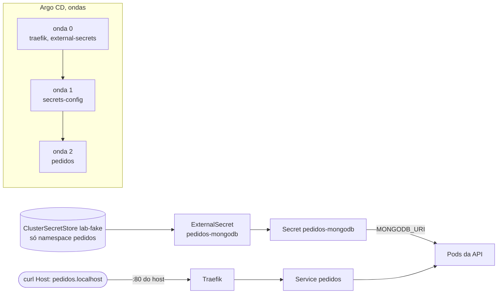

# 03 - Identidade e ingress (Etapa 3)

Duas metades, como no resto do projeto: a **identidade na AWS** (Pod Identity) é código validado e testado offline,
e o **ingress e o segredo** rodam de verdade no kind, com substitutos locais.

## O que é real e o que é substituto

| Peça do roteiro | Neste projeto | Status |
|---|---|---|
| Roles do LBC e do ESO, policies e `aws_eks_pod_identity_association` | Código em `terraform/cluster/identidade.tf`, com `terraform test`, Rego e mutação | validado, **não aplicado** |
| AWS Load Balancer Controller + ALB compartilhado (`IngressGroup`) | Traefik (chart 42.1.3, Traefik v3.7.16) com o `Ingress` da API | LBC e ALB: **não executados** |
| External Secrets + Secrets Manager | External Secrets 2.14.0 com o provider `fake` | provider AWS: **não executado** |
| Teste de negação (pod sem identidade na AWS) | `ClusterSecretStore` com `conditions.namespaces` e um `ExternalSecret` intruso | **parcial** |

Por que não o ingress-nginx: o repositório foi arquivado em março de 2026 e não recebe correções. O `Ingress`
continua sendo o recurso padrão do Kubernetes; trocar de controller muda só `ingressClassName` e a instalação.

## Fluxo no cluster

As ondas existem porque `secrets-config` e `pedidos` usam os CRDs do External Secrets, que só existem depois que o
operador sincroniza. Sem as ondas, o primeiro sync falhava na validação a seco.

## Identidade (só código)

`terraform/cluster/identidade.tf`:

| Role | Conta de serviço | Permissão |
|---|---|---|
| `eks-lab-lbc` | `kube-system/aws-load-balancer-controller` | Policy oficial do LBC v3.6.2, sem alterações |
| `eks-lab-external-secrets` | `external-secrets/external-secrets` | `GetSecretValue` e `DescribeSecret` só em `secret:eks-lab/*` |

A trust policy usa `pods.eks.amazonaws.com` com `sts:AssumeRole` e `sts:TagSession` (a IRSA usaria o OIDC do cluster).
`var.secrets_prefix` recusa curinga e prefixo sem barra final.

Verificações: 4 testes novos em `terraform test` (9 no total), que **falham de verdade** quando o código quebra
(troquei o princípio para `ecs-tasks.amazonaws.com` e a ação para `secretsmanager:*` e os testes de principal e de
prefixo falharam). A política Rego `policy/iam.rego` nega `Action "*"`, `secretsmanager:*`, ação do Secrets Manager
com `Resource "*"` e role de pod confiando em `ecs-tasks`; tem 6 testes novos (16 no total). A policy oficial do LBC,
que tem `Resource "*"` em ações de leitura do EC2, passa na política.

## Resultados

Executados em 2026-10-30.

| Verificação | Resultado |
|---|---|
| Aplicações do Argo CD | As 5 (`root`, `traefik`, `external-secrets`, `secrets-config`, `pedidos`) em `Synced/Healthy` |
| API pelo ingress | `curl -H "Host: pedidos.localhost" http://localhost/actuator/health` devolveu `200` e `{"status":"UP"}`; `POST /pedidos` gravou o pedido |
| Sem o `Host` certo | `404` do Traefik |
| Segredo no pod | `MONGODB_URI` vem de `secretKeyRef` no Secret `pedidos-mongodb`; o manifesto da API no Git não tem mais a URI |

## Teste de negação (parcial)

Manifesto: [experimentos/negacao-external-secrets.yaml](experimentos/negacao-external-secrets.yaml). Um `ExternalSecret`
no namespace `intruso` tenta ler a mesma chave pelo `ClusterSecretStore lab-fake`.

| Quem | Resultado |
|---|---|
| `pedidos` (permitido) | `SecretSynced`, `READY True`, Secret criado |
| `intruso` (fora de `conditions.namespaces`) | `SecretSyncedError`, `READY False`, o Secret `roubado` **não foi criado**. Evento: `could not get secret data from provider`. Log do controller: `using cluster store "lab-fake" is not allowed from namespace "intruso": denied by spec.condition` |

O que isto **não** prova: que um pod sem Pod Identity recebe `AccessDenied` do IAM. Aqui a negação é do operador, não
da AWS. Esse teste (pod `amazon/aws-cli` sem associação lendo o segredo) ficou **não executado**.

## Problemas encontrados

| Problema | Causa | Solução |
|---|---|---|
| Aplicação `traefik` e `pedidos` em `Progressing` para sempre | O `Ingress` ficava sem endereço (o Service era `LoadBalancer`, que no kind nunca recebe IP) e o Argo CD só dá `Healthy` com endereço | Service `ClusterIP` e `ingressEndpoint.ip: 127.0.0.1`, sem `publishedService` |
| `service.type: ClusterIP` ignorado | No chart 42 o campo é `service.spec.type` | Valor corrigido |
| Pod novo do Traefik `Pending` | O `hostPort 80` do pod antigo ocupa o nó e o rolling update padrão sobe o novo antes de matar o antigo | `maxSurge: 0` e `maxUnavailable: 1` |
| `helm show values` falhava | O Helm do usuário tem repositórios sem índice em cache | `HELM_REPOSITORY_CONFIG` e `HELM_REPOSITORY_CACHE` apontando para uma pasta temporária |

## Decisões

| Decisão | Motivo |
|---|---|
| Valor do segredo no `ClusterSecretStore` (Git) | A URI não tem credencial (Mongo sem autenticação, só no laboratório). Com segredo de verdade, o provider seria `aws` e o valor nunca iria ao Git |
| `ClusterSecretStore` restrito por namespace | Análogo local da permissão mínima por conta de serviço |
| Ondas de sincronização por anotação | Operadores antes de quem usa os CRDs deles |
| Policy oficial do LBC copiada sem edição | Ela é mantida pelo projeto; a versão fica registrada no comentário do `identidade.tf` |
