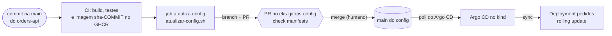

# 04 - Entrega contínua (Etapa 4)

Do commit na API até a imagem nova rodando no cluster, sem nenhum `kubectl apply` manual.

## Fluxo

Duas pessoas, dois momentos: o robô só **propõe** (abre o PR); quem decide é o merge. Depois dele, o Argo CD faz o resto.

## Status de cada peça

| Peça | Status | Como foi verificada |
|---|---|---|
| Argo CD instalado pelo Terraform (camada `bootstrap`) e `root.yaml` no `make up` | executado (Etapa 2) | `make up` completo no kind |
| `.github/scripts/atualizar-config.sh` | executado | `DRY_RUN=1` em 4 cenários (tag nova, mesma tag, imagem errada, variáveis ausentes) e uma execução real que abriu o PR |
| PR no config com o check `manifests` | executado | PR #1 aberto em 5 s; check verde em 10 s |
| Merge e sync no cluster | executado | Medido abaixo |
| Proteção da `main` do config (PR obrigatório e check `manifests`) | executado | `gh api .../branches/main/protection` |
| Job `atualiza-config` no GitHub Actions | **não executado, por decisão** | Escrito no `ci.yml` do orders-api (branch `etapa-9-gitops-config`); sem token e sem execução no GitHub |

## Tempos medidos (2026-10-30, sem forçar refresh)

| Trecho | Tempo |
|---|---|
| Script abre o PR | ~5 s |
| Check `manifests` | ~10 s |
| Merge até o Argo CD aplicar a imagem nova | **~82 s** (poll natural; o teto padrão é 3 min) |
| Merge até 2 réplicas novas `Ready` | **~101 s** |

A imagem usada foi `sha-442233d…`, um build mais antigo da própria API, só para exercitar o caminho: o PR trocou o
`newTag` de `sha-bfef4ca…` para ela e o rolling update subiu 2 réplicas novas sem derrubar o serviço. Depois do
rollout, a API respondia `200` pelo ingress.

## Decisões

| Decisão | Motivo |
|---|---|
| Um só ambiente (`workloads/pedidos/`), sem overlays | Laboratório de um cluster; overlays `dev`/`prod` seriam pasta sem função |
| O CI propõe por PR, não faz push direto | A `main` do config é a fonte da verdade do cluster; mudança entra por revisão |
| Proteção da `main`: PR + check, 0 aprovações, admin pode contornar | Sozinho, ninguém aprova o próprio PR. O check `manifests` é o freio real |
| `awk` no lugar de `kustomize edit set image` | O script roda no runner e na máquina local sem instalar o `kustomize`; o arquivo é simples e o script falha se a imagem não existir nele |
| Token com acesso só ao repositório de config (contents e pull requests) | Mínimo para clonar, enviar a branch e abrir o PR; comprometido, só alcança esse repositório |
| Sem o token, o job avisa e termina em sucesso | O CI da API não quebra para quem ainda não configurou o secret |
| Tag `sha-<commit completo>`, nunca `latest` | Reprodutível, reverte com `git revert`, e a política do Kyverno (Etapa 6) proíbe `latest` |

## Problemas encontrados

| Problema | Causa | Solução |
|---|---|---|
| Workflow `Validate` do config falhava desde a Etapa 3 | `kubeconform -strict` sem schema para `ExternalSecret` e as CRDs do Argo CD | Catálogo de CRDs da comunidade e `-ignore-missing-schemas` |
| `sed` do script quebrava com `/` e `.` no nome da imagem | Escape dentro de aspas duplas | Troquei por `awk` comparando campos, sem regex |
| `prometheus` dava `404` no teste da API | Testes do Spring Boot desligam a exportação de métricas por padrão | Propriedades religando a exportação, só nesse teste |

## O que não será executado (decisão do projeto)

O projeto fica **só no computador**: nada na AWS, nenhum agendamento no GitHub e nenhum workflow que precise ser
disparado ou configurado com segredo. Por isso:

- O job `atualiza-config` do GitHub Actions (e o secret `CONFIG_REPO_TOKEN`) ficam como **não executado**: o código
  existe na branch `etapa-9-gitops-config` do `orders-api`, mas nenhum token foi criado e o job nunca rodou.
- O caminho "commit na API até o cluster" foi provado sem o CI: o **mesmo script** abriu o PR, e o merge foi seguido
  pelo Argo CD (tempos acima). O que o Actions acrescentaria é só automatizar o disparo do script.
- A imagem com métricas e probes não passa pelo GHCR: para a Etapa 5 ela é construída na máquina
  (`docker build`) e carregada no kind (`kind load docker-image`).
